<div align="center">


# Umbra — Privacy-Preserving Machine Learning Framework

**Train models on sensitive data with differential privacy and federated learning, then attack them to measure what still leaks.**


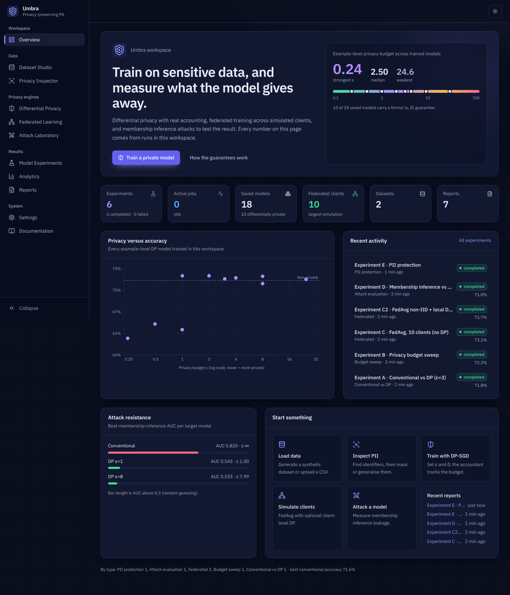

</div>

---

## Contents

[Problem](#problem-statement) · [Features](#features) · [Architecture](#architecture) ·
[Install](#installation) · [Run](#running-the-application) · [Modules](#modules) ·
[Differential privacy](#differential-privacy) · [Federated learning](#federated-learning) ·
[Privacy attacks](#privacy-attacks) · [Results](#experimental-results) ·
[Screenshots](#screenshots) · [Testing](#testing) · [Security](#security-considerations) ·
[Limitations](#limitations) · [Roadmap](#future-improvements) · [License](#license)

## Problem statement

Machine-learning models memorise their training data. A model trained on medical or financial
records can reveal whether a particular person was in the training set (membership
inference) or expose their attributes, even if the raw data is never published. Masking a few
columns or "keeping data on device" does not fix this by itself.

Umbra is a local, research-oriented platform that puts the main defences and the main attacks
side by side, so their effects can be **measured** rather than assumed:

* **Differential privacy** (DP-SGD via Opacus) with real privacy accounting.
* **Federated learning** (FedAvg) with client-level and per-client DP options.
* **Privacy attacks** (membership and attribute inference) to test the resulting models.
* **Privacy-aware data processing** (PII detection, masking, generalisation, local DP).

Every number in the UI and in this README comes from an actual run. The framework is explicit
about which results are formal guarantees, which are empirical evidence, and which are
illustrations.

## Objectives

1. Implement genuine (ε, δ)-DP training with a recognised accountant and documented assumptions.
2. Simulate federated learning and show where it does and does not protect privacy.
3. Quantify leakage with standard attacks, before and after applying defences.
4. Provide reusable data-protection tooling with honest claims (no "anonymised" labels).
5. Wrap it in a polished, accessible application that runs on an ordinary Windows laptop.

## Features

| Area | What you get |
|---|---|
| **Dataset Studio** | Synthetic datasets with fictional people, CSV/TSV upload with strict validation, profiling, data-quality score, histograms, paginated preview, CSV-injection-safe export |
| **Privacy Inspector** | Header + content PII detection (e-mail, phone, card numbers with Luhn, IPs, IDs, names), quasi-identifier detection, k-anonymity, seven protections (suppress, redact, mask, HMAC pseudonymise, generalise, local DP), before/after view |
| **DP Studio** | DP-SGD with Poisson sampling, target-ε or fixed-σ, RDP / PRV accountants, live ε calculator with three-accountant comparison, per-epoch ε, clip diagnostics, conventional-vs-DP and budget sweeps |
| **Federated Studio** | FedAvg with IID or Dirichlet non-IID clients, DP-FedAvg (client-level DP), local DP-SGD per client, live topology, participation grid, communication statistics |
| **Attack Laboratory** | Loss-threshold, entropy-threshold and shadow-model membership inference; calibrated thresholds; ROC, TPR at 1 %/10 % FPR; heuristic attack-implied ε; attribute inference |
| **Experiments / Analytics / Reports** | Persistent runs with live progress and cancellation, model artifacts with verified reload, cross-experiment analytics, Markdown / HTML / JSON reports |
| **Engineering** | FastAPI + SQLite, JSON for all app state and weights reloaded only with `weights_only=True`, Host allow-list and streaming upload limit, security headers, PII-scrubbing logs, pytest + Vitest suites, Ruff, mypy (Windows/Linux/macOS targets), Bandit, pip-audit, PowerShell automation, Dockerfile (untested) |

## Architecture

```
React 18 + TypeScript + Tailwind v4 + Recharts  ──fetch /api──▶  FastAPI (security headers, validation)
                                                                     │
                       ExperimentRunner (thread pool, progress, cancellation) ── SQLite metadata
                                                                     │
   core.data (load · PII · transforms · encoder) │ core.ml (MLP · train · safe artifacts)
   core.privacy (Opacus DP-SGD · RDP/PRV)        │ core.federated (FedAvg · DP-FedAvg · local DP)
   core.attacks (MIA · shadow models · attribute inference) │ core.reports (MD/HTML/JSON)
```

Details: [`docs/ARCHITECTURE.md`](docs/ARCHITECTURE.md).

## Technology stack

| Layer | Technology (versions verified in this build) |
|---|---|
| ML / privacy | PyTorch 2.15, Opacus 1.6.0, scikit-learn 1.9.1, NumPy 2.5, pandas 3.1, SciPy 1.18 |
| Backend | FastAPI 0.162, Uvicorn 0.54, Pydantic 2.14, pydantic-settings, SQLite |
| Frontend | React 18.3, TypeScript 5.9, Vite 6.4, Tailwind CSS 4.3, React Router 7, TanStack Query 5, Recharts 2.15, Framer Motion, Lucide icons, IBM Plex (self-hosted) |
| Quality | pytest 9, Vitest 5, Testing Library, Ruff, mypy, Bandit, pip-audit, npm audit, Playwright (screenshots) |
| Ops | PowerShell scripts for Windows, shell scripts for Linux/macOS, Dockerfile + Compose |

## System requirements

Windows 10/11 (verified) or Linux (verified); macOS untested · Python 3.13 tested
(3.10+ supported in code, untested) · Node.js 18+ (UI build only) ·
4 GB RAM · ~1.5 GB disk · CPU is enough; an NVIDIA GPU is used automatically if present.
No paid APIs, no cloud services, no internet access needed after installation.

## Installation

### Windows

```powershell
cd path\to\your\clone          # the folder that contains setup.ps1
Set-ExecutionPolicy -Scope Process -ExecutionPolicy Bypass   # only if scripts are blocked
.\setup.ps1        # venv + Python packages + UI build   (add -Cuda for an NVIDIA GPU)
```

### Linux (macOS untested)

```bash
python3 -m venv .venv
.venv/bin/pip install torch --index-url https://download.pytorch.org/whl/cpu   # CPU wheel; skip on macOS
.venv/bin/pip install -r requirements.txt -r requirements-dev.txt
(cd frontend && npm ci && npm run build)
```

Troubleshooting and configuration: [`docs/INSTALLATION.md`](docs/INSTALLATION.md).

## Running the application

```powershell
.\run.ps1                # http://127.0.0.1:8000  (API docs at /api/docs)
.\run.ps1 -Dev           # backend :8000 + Vite hot reload on http://127.0.0.1:5173
.\verify.ps1             # every check: tests, lint, types, security, smoke tests, UI build
```

On Linux use `./run.sh` and `./verify.sh`. A `Dockerfile` and `docker-compose.yml` are included but **have not been built or tested**.

**First five minutes:** Overview → *Create a demo dataset* → Privacy Inspector (see what is
identifying) → DP Studio → *Train both models* → Attack Laboratory → *Run attack evaluation* →
Reports.

## Modules

1. **Dataset management** (`core/data/loader.py`, `synthetic.py`, `store.py`) — validated
   ingestion, profiling, storage under server-generated IDs.
2. **Differential privacy engine** (`core/privacy/dp.py`, `accounting.py`) — Opacus DP-SGD and
   stand-alone accounting.
3. **Federated simulator** (`core/federated/fedavg.py`).
4. **Attack laboratory** (`core/attacks/membership.py`).
5. **Privacy-preserving processing** (`core/data/pii.py`, `transforms.py`, `preprocessing.py`).
6. **Experimentation** (`core/experiments/`, `core/ml/`, `core/reports/`) — seven experiment
   types, artifacts, reports.

## Differential privacy

A mechanism is (ε, δ)-DP if adding or removing any one record changes the probability of any
output by at most a factor e^ε, plus δ. Umbra's DP-SGD clips each per-example gradient to norm
C, adds Gaussian noise σ·C, samples batches by Poisson sampling, and composes all steps with
Opacus' **RDP** accountant (or **PRV**). In target-ε mode the noise multiplier is found by
search; ε reported after training is read back from the accountant, and a test recomputes it
independently.

* **Central DP** — trusted trainer, private model (DP Studio).
* **Local DP** — each value randomised before use (Inspector "Local DP": Laplace / randomized response).
* **Client-level DP** — protects whole clients in federated learning (DP-FedAvg).

What the guarantee does *not* cover (preprocessing statistics, hyper-parameter search, users
with many rows, non-cryptographic RNG) is listed in
[`docs/PRIVACY_METHODOLOGY.md`](docs/PRIVACY_METHODOLOGY.md) and next to every result in the UI.

## Federated learning

FedAvg: clients train locally from the global model and the server averages their weights by
sample count. Raw data stays on clients, but **updates can still leak**, so FedAvg alone is
labelled "no formal guarantee". Two private variants are implemented:

* **DP-FedAvg** — Poisson client sampling, per-client update clipping, Gaussian noise at the
  server, RDP accounting over rounds → client-level (ε, δ).
* **Local DP-SGD** — each client runs Opacus DP-SGD with its own accountant → example-level
  (ε, δ) per client that holds even against a curious server.

## Privacy attacks

* **Loss threshold** (Yeom et al. 2018) and **entropy threshold** (Salem et al. 2019).
* **Shadow models** (Shokri et al. 2017) with a gradient-boosted attack classifier.
* **Attribute inference** (Fredrikson et al. 2015) on the most label-informative categorical feature.

Thresholds are fitted on a calibration half and reported on a disjoint half. Metrics: AUC,
accuracy, precision, recall, advantage, TPR at 1 %/10 % FPR, and a heuristic attack-implied ε
(not a valid DP audit: it comes from a single training run). A weak attack is evidence, not proof, of privacy.

## Experiment instructions

Each experiment can be run from its studio, or headlessly while `.\run.ps1` is running in
another window:

```powershell
.\.venv\Scripts\python.exe scripts\run_experiments.py      # Linux: .venv/bin/python scripts/run_experiments.py
```

Results are written to
`docs/results/experiments.json` and a report is generated for each. Full method and discussion:
[`docs/EXPERIMENTS.md`](docs/EXPERIMENTS.md).

## Experimental results

Synthetic Patient Risk dataset (4,020 rows, fictional), MLP, CPU only (2 cores). Copied from
[`docs/results/experiments.json`](docs/results/experiments.json).

**A — Conventional vs DP-SGD (target ε = 3, δ = 1e-5)**

| Model | Accuracy | Precision | Recall | F1 | ROC-AUC | ε | Train time |
|---|---|---|---|---|---|---|---|
| Conventional | 71.56 % | 62.93 % | 60.31 % | 0.616 | 0.762 | none | 0.64 s |
| DP-SGD | 71.81 % | 64.50 % | 56.58 % | 0.603 | 0.776 | 2.998 | 1.66 s |

**B — Privacy budget sweep** (conventional reference 71.56 %)

| Target ε | 0.25 | 0.5 | 1 | 2 | 4 | 8 |
|---|---|---|---|---|---|---|
| Achieved ε | 0.242 | 0.492 | 1.000 | 1.996 | 3.995 | 7.999 |
| Noise σ | 12.50 | 6.56 | 3.52 | 2.01 | 1.26 | 0.88 |
| Accuracy | 62.19 % | 64.51 % | 72.31 % | 72.31 % | 71.97 % | 72.22 % |
| F1 | 0.000 | 0.141 | 0.583 | 0.611 | 0.605 | 0.606 |

Below ε ≈ 1 the model collapses to the majority class; from ε = 1 up, utility matches the
non-private model on this (easy, low-dimensional) task.

**C — Federated learning** (10 clients, 20 rounds, 5 per round)

| Setting | Final global accuracy | Centralized | Privacy |
|---|---|---|---|
| IID, no DP | 73.13 % | 71.31 % | none (FedAvg alone) |
| Dirichlet α = 1, local DP-SGD σ = 1 | 71.72 % | 71.31 % | ε = 24.6 (worst client, δ = 1e-4) |

**D — Membership inference** (600 members, 120-epoch over-parameterised target, 3 shadow models)

| Target | Test acc | Train acc | Best attack AUC | Max advantage | Attack-implied ε (heuristic) |
|---|---|---|---|---|---|
| Conventional | 63.08 % | 100.00 % | **0.820** (shadow) | 0.591 | 2.36 |
| DP ε = 0.995 | 63.58 % | 63.83 % | 0.543 | 0.037 | 0.00 |
| DP ε = 7.99 | 71.04 % | 74.17 % | 0.533 | 0.040 | 0.00 |

DP brought every attack to chance level; at ε ≈ 8 the DP model was also the most accurate,
because it no longer over-fits. Attribute inference did not beat the majority baseline for
any target (reported as a negative result).

**E — PII protection**: 4 direct identifiers → 0; records unique on age + gender + ZIP + city
93.2 % → 4.8 %; k-anonymity still 1 (so **not** anonymous); accuracy 71.48 % → 69.90 %.

## Screenshots

All captured from the running application with real experiment data
(more in [`assets/screenshots/`](assets/screenshots/)).

| | |
|---|---|
| **Dataset Studio**<br>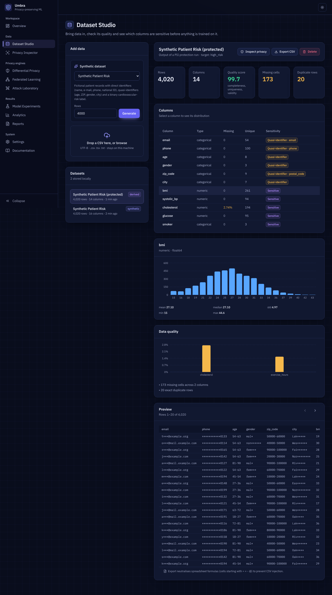 | **Privacy Inspector**<br>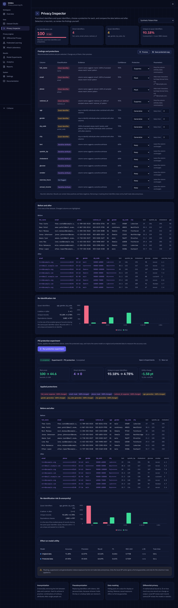 |
| **Differential Privacy Studio**<br>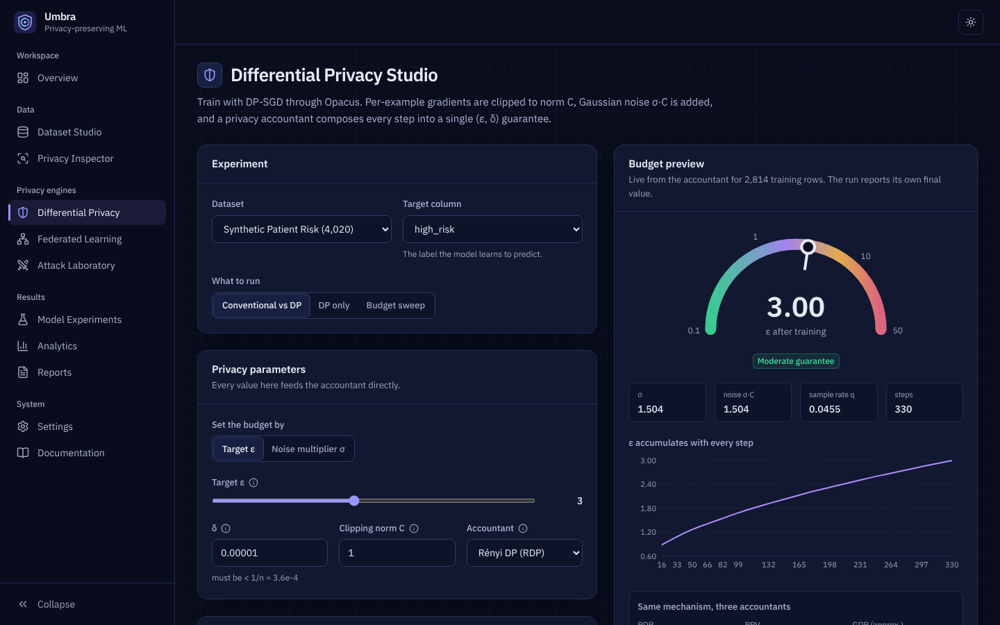 | **DP training results**<br>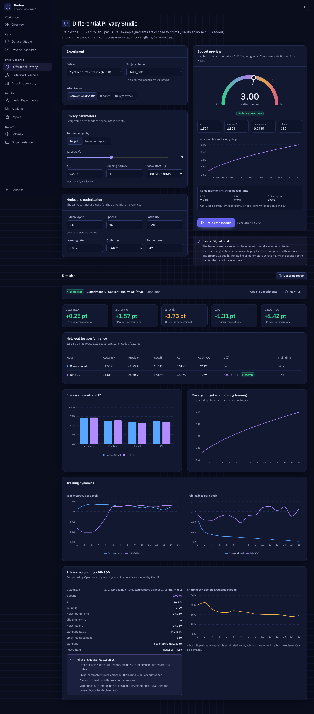 |
| **Federated Learning Studio**<br>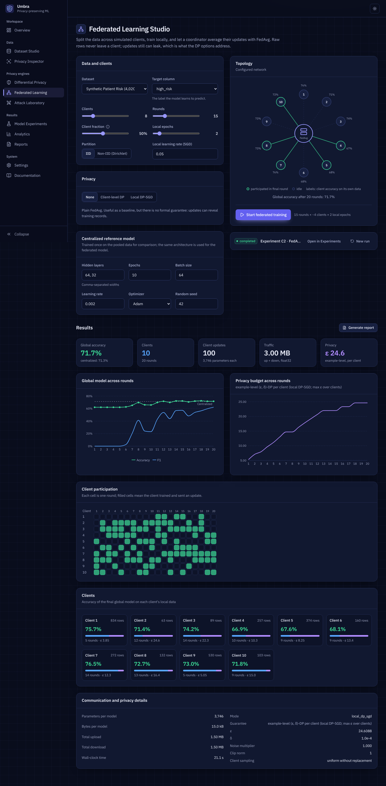 | **Attack Laboratory**<br>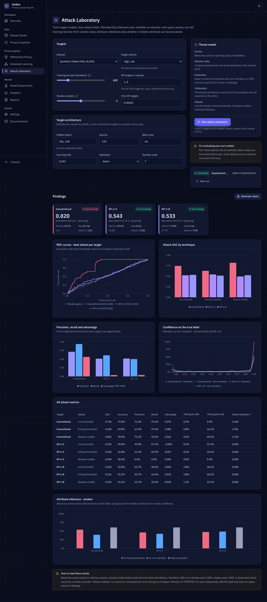 |
| **Experiment comparison**<br>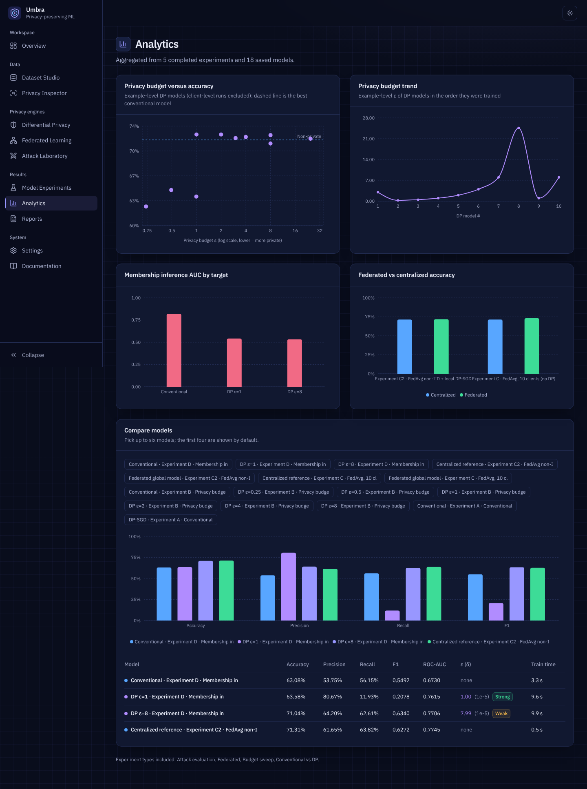 | **Privacy reports**<br>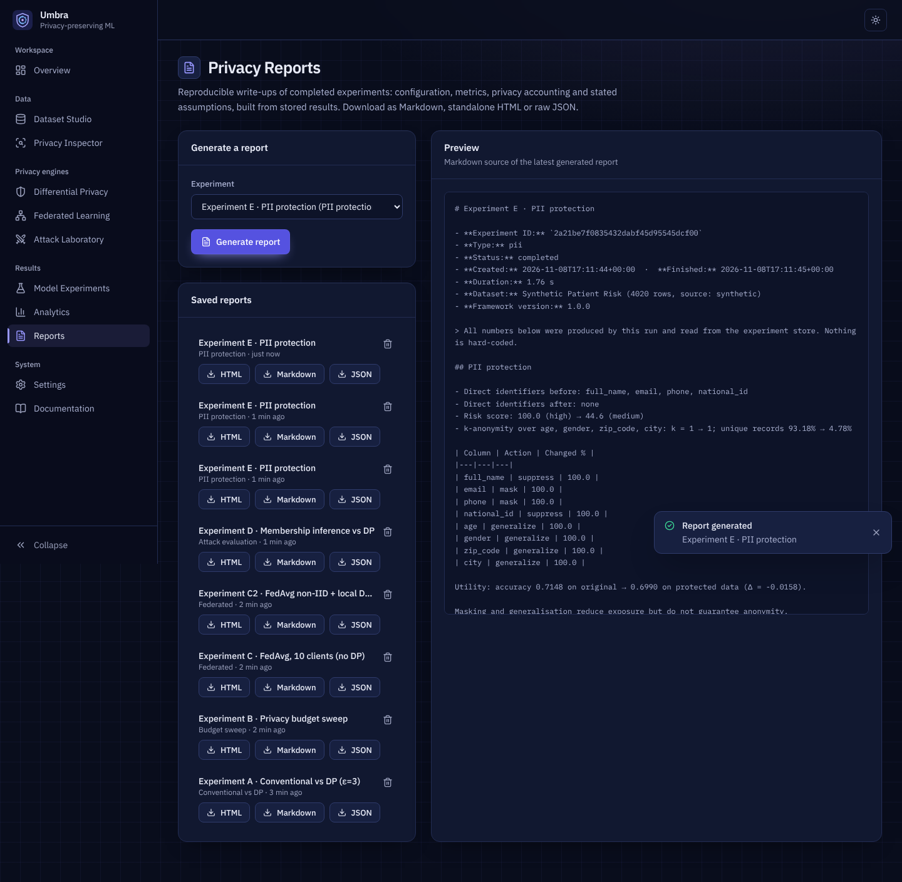 |
| **Light theme**<br>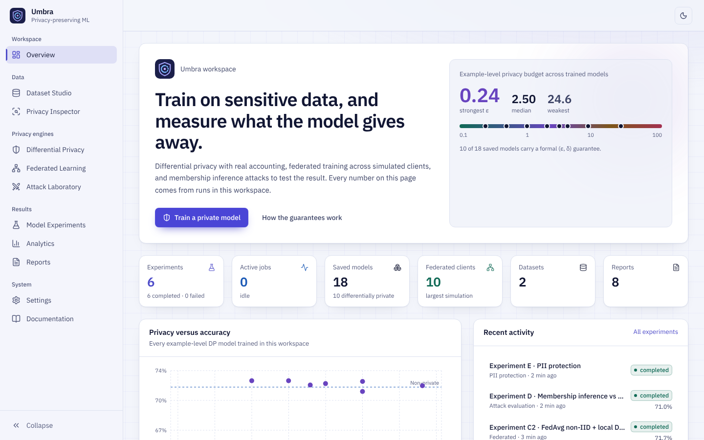 | **Phone (390 px)**<br>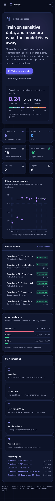 |

## Testing

```powershell
.\verify.ps1
```

| Check | Result (this build) |
|---|---|
| pytest (data, PII, transforms, DP-SGD, accounting, FedAvg, attacks, artifacts, API, security, cross-platform) | 98 passed, 0 failed, 0 skipped |
| Vitest (format helpers, API client errors, accessible components, navigation regression) | 9 passed |
| Smoke tests (ML, DP, FL, attack, PII, reload, report) | 7 / 7 |
| Ruff lint + format · mypy for Windows, Linux and macOS (34 files) | clean |
| Bandit (4.0 k LOC) | 0 issues (5 reviewed `nosec` on allow-listed SQL identifiers) |
| pip-audit · npm audit | 0 known vulnerabilities |
| Browser: 11 pages, 4 viewports, 2 themes + 12-step workflow from an empty install | 0 console errors, 0 horizontal overflow |
| Accessibility: axe-core 4.14, WCAG 2.1 A/AA + best practice, all pages, both themes, result views, mobile drawer | 0 violations |

Full details, including what was **not** verified: [`docs/VERIFICATION_REPORT.md`](docs/VERIFICATION_REPORT.md).

## Security considerations

Local single-user tool: binds to 127.0.0.1, **no authentication** — do not expose it on a
network. Controls include upload validation and size limits, path-traversal-proof storage,
JSON for application state and `torch.load(weights_only=True)` (restricted unpickler) for weights, parameterised SQL, CSV-injection protection,
HTML escaping, CSP and other security headers, PII-scrubbing logs. Threats, mitigations and
residual risks: [`docs/THREAT_MODEL.md`](docs/THREAT_MODEL.md). Reporting: [`SECURITY.md`](SECURITY.md).

This project makes **no claim of regulatory compliance** (GDPR, HIPAA, DPDP Act or other).

## Limitations

* Results come from synthetic data; they demonstrate mechanisms, not real-world utility.
* DP accounting excludes preprocessing statistics and hyper-parameter search across runs.
* PII detection is heuristic (format- and English-centric) and will miss things.
* Federated learning is simulated in one process (no networking, secure aggregation or
  robustness to malicious clients). Client-level DP needs far more clients than a laptop
  simulation uses to be useful.
* Attack results describe only the attacks implemented; stronger attacks (e.g. LiRA) are not
  implemented, and the attack-implied ε is a heuristic, not a DP audit.
* No authentication; not a production service.

## Future improvements

* LiRA and other likelihood-ratio membership attacks; gradient-inversion demo for FedAvg.
* Private preprocessing (DP means/quantiles) so the whole pipeline is covered by ε.
* Secure aggregation simulation and Byzantine-robust aggregators (median, Krum).
* Public benchmark loaders (UCI Adult, Texas-100) with licence notices.
* Optional authentication and a Host-header allow-list for multi-user deployments.
* WebSocket progress streaming; Plotly export of charts.

## Project structure

```
├── backend/ppml/            FastAPI app and all ML / privacy code
│   ├── api/                 HTTP routes
│   └── core/                data · ml · privacy · federated · attacks · experiments · reports
├── backend/tests/           pytest suite
├── frontend/src/            React app (pages, components, lib)
├── scripts/                 smoke tests, experiment runner, PowerShell helpers
├── docs/                    architecture, threat model, methodology, experiments, API, reports
├── assets/screenshots/      real screenshots
├── setup.ps1 · run.ps1 · verify.ps1 · run.sh · verify.sh
├── Dockerfile · docker-compose.yml · requirements*.txt · .env.example
└── README · LICENSE · SECURITY · CONTRIBUTING · CHANGELOG
```

## License

[MIT](LICENSE) © 2026 Girish Kusanuramath
